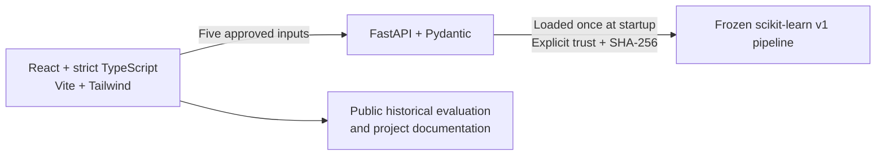

# FreightGuard AI

An educational logistics dashboard that explores shipment delay prediction with
an honest account of model quality. Built as a Python/ML and full-stack portfolio
project; **not operationally validated and not a production alerting service**.

## What the application does

- Validates a conservative five-input order-level data contract.
- Prepares chronological splits and train-only preprocessing.
- Preserves a reproducible baseline experiment and a single frozen test evaluation.
- Serves trusted, checksum-verified v1 predictions through FastAPI.
- Provides a responsive React dashboard with Overview, Shipment Prediction,
  Model Insights, System Status, and About/Documentation.
- Shows historical metrics, transparent limitations, actual connectivity, and
  helpful validation/loading/error states. No live shipment counts are invented.

## Architecture and stack



The fitted preprocessing stays inside the model pipeline. Raw datasets never enter
the frontend or container image. There is no database, user account service, or
shipment-record storage. Tests use synthetic fixtures. Vitest/Testing Library,
Playwright/axe, pytest and Ruff provide automated checks.

## Model limitations: read before using a prediction

V1 predicts delay for one order at finalized checkout shipping-plan time,
conditional on eventual non-cancellation. Its inputs are scheduled shipping days,
shipping mode, market, broad order region and country. It excludes personal
information, IDs and delivery outcomes.

Random Forest and threshold **0.40** were selected using validation F1. At that
frozen threshold, **every one of the 13,071 final test orders was classified late**:
5,547 false positives, no true negatives. High recall does not make this a useful
selective-alert system. Supported within-shipping-mode ranking is near chance;
shipping-plan patterns explain most of the model's signal.

| Historical final-test metric | Frozen v1 result |
| --- | ---: |
| ROC-AUC | 0.7494 |
| Precision | 0.5756 |
| Recall | 1.0000 |
| F1 | 0.7307 |

These are documented historical results, not deployment performance. Experimental
scores are not delivery guarantees or validated order-specific probabilities.
The old retail dataset, retrospective cancellation exclusions, geographic shift,
uncertain label timing, and unresolved provenance/license limit generalization.
See [training](docs/TRAINING.md) and [model quality](docs/MODEL_QUALITY.md).
The model, threshold and original test results remain unchanged. Do not retrain,
retune or repeat this holdout evaluation to make the demo look better.

## Local setup

Use Python **3.12** and Node **>=22.12** (tested here with 24.20.0). Obtain this
repository through its GitHub Code/clone instructions, then run commands from its
root. No hosting credentials or external account are needed.

For a fresh environment:

```sh
python3.12 -m venv .venv
source .venv/bin/activate
python -m pip install -r requirements/dev.txt
python -m pip install --no-deps -e .
cd frontend
npm ci
cd ..
```

Reuse an existing working `.venv` rather than replacing it. Python requirement
files snapshot the reviewed installed versions; they are not hash-locked or a
promise of cross-platform reproduction. `frontend/package-lock.json` supports
`npm ci`. See [deployment readiness](docs/DEPLOYMENT.md) for remaining verification.

## Start the application

Terminal 1, from the repository root:

```sh
source .venv/bin/activate
FREIGHTGUARD_TRUST_LOCAL_MODEL=false python -m uvicorn freightguard.api.app:app --host 127.0.0.1 --port 8000 --no-access-log
```

That starts safely **without model trust**: health and information work, predictions
are unavailable. To enable the already-reviewed, locally generated original v1
artifact, first verify its SHA-256, then restart using:

```sh
shasum -a 256 data/processed/models/v1/pipeline.joblib
export FREIGHTGUARD_TRUST_LOCAL_MODEL=true
export FREIGHTGUARD_MODEL_SHA256=e3d46fa78998d13584ed7d7ea88bd321c69e2773aa9b6f18eab20eee73d0ddef
python -m uvicorn freightguard.api.app:app --host 127.0.0.1 --port 8000 --no-access-log
```

A matching hash does not make an untrusted pickle safe. Only opt in for an artifact
you generated/reviewed and trust locally. No model uploads or automatic downloads
are supported. Artifacts are intentionally absent from Git. Fresh-checkout
artifact generation requires the separately obtained dataset and the one-time
procedure in [API setup](docs/API.md); never delete an existing frozen run.

Terminal 2, from the repository root:

```sh
cd frontend
npm ci
cp .env.example .env.local
npm run dev
```

Open <http://127.0.0.1:5173>. API docs: <http://127.0.0.1:8000/docs>.
`VITE_API_BASE_URL` is public browser configuration, never a place for secrets.
Default API CORS allows only the two explicit localhost development origins.
Stop servers with Ctrl+C. Nothing is externally deployed.

Synthetic form example: `4`, `Standard Class`, `Europe`, `Western Europe`,
`Francia`. On the original v1 artifact it displays **42.7%**, experimental **Late**,
at 0.40. Geography dropdowns retain the dataset's original category spellings.

## API

| Endpoint | Purpose |
| --- | --- |
| `GET /health` | Application health plus model readiness |
| `GET /model/info` | v1 contract, categories, readiness and limitations |
| `POST /predict` | Exactly five approved fields; experimental score/classification |

Errors use consistent JSON, without payloads, stack traces or local paths.
Missing/untrusted/corrupt artifacts leave predictions unavailable (503). Liveness
HTTP 200 is not evidence of model readiness. See [API reference](docs/API.md).

## Checks and screenshots

From the repository root:

```sh
.venv/bin/python -m pytest -q
.venv/bin/python -m ruff check .
# All maintained code, preserving the user's inspection script:
.venv/bin/python -m ruff check . --exclude src/freightguard/inspect_data.py
.venv/bin/python scripts/audit_repository.py
cd frontend
npm run typecheck
npm run lint
npm test
npm run build
npm audit --audit-level=moderate
```

Full Ruff intentionally still reports the original `inspect_data.py` import issue;
its empty index entry and implemented working version are preserved. Do not use
blanket staging or auto-fix that script during a release checkpoint.

For integration/accessibility checks and screenshots, start the trusted backend
and `npm run preview` (instead of `npm run dev`) on port 5173, then:

```sh
cd frontend
npx playwright install chromium
npm run test:e2e
```

Browser output/screenshots are under ignored `frontend/test-results/`. Use only
synthetic examples for portfolio images; review screenshots before manually adding
any to Git. Do not photograph raw datasets, terminals with credentials, or personal
records. The suite covers desktop/mobile navigation, predictions, error states,
keyboard skip navigation, automated accessibility and narrow-screen overflow.
Automated checks do not replace manual assistive-technology review.

## Release status

Milestone 6 is committed as `d9cdf73`. The final independent audit accepted
Milestone 7 for the user-authorized source checkpoint. Verdict: **READY FOR
EDUCATIONAL PORTFOLIO RELEASE** for the native/local application. See the
[final audit](docs/FINAL_AUDIT.md) for executed checks and unresolved limits.
No tag, push or external deployment was performed.

Local non-container inference is verified. Docker is unavailable on the audit
machine: Compose/Dockerfile/Nginx configuration is prepared but container builds,
image vulnerability scans and container startup are **not verified**. GitHub
Actions is prepared but has not run remotely. This is portfolio release
preparation, not production certification.

See the [release checklist](docs/RELEASE_CHECKLIST.md),
[security findings](docs/SECURITY.md), and [deployment instructions](docs/DEPLOYMENT.md).
Before public hosting, separately review TLS, authentication, rate limits, resource
limits, logging, artifact distribution and exact allowed origins. Choose a source
license and confirm dataset/artifact sharing rights before distribution.

## Documentation

- [Architecture](docs/ARCHITECTURE.md) and [development](docs/DEVELOPMENT.md)
- [Data/privacy contract](docs/DATA_AND_ML.md) and [preparation](docs/PREPARATION.md)
- [Training/evaluation](docs/TRAINING.md) and [quality investigation](docs/MODEL_QUALITY.md)
- [Frontend](docs/FRONTEND.md), [API](docs/API.md), and [deployment](docs/DEPLOYMENT.md)
- [Security](docs/SECURITY.md) and [release checklist](docs/RELEASE_CHECKLIST.md)
- [Progress/evidence](docs/PROGRESS.md), [decisions](docs/DECISIONS.md),
  [milestones](docs/MILESTONES.md), and [agent instructions](AGENTS.md)
