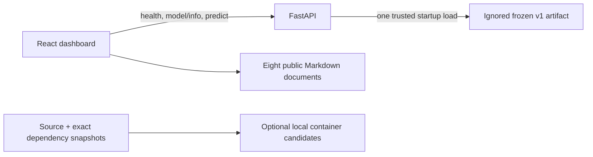

# Current architecture

Current handoff: milestones 1–7 passed the native/local audit, with the final M7
source checkpoint authorized by the user (2026-10-29). Native application integration is tested;
Docker runtime and remote CI are pending. No public release or operational model
approval. Earlier engineering/audit details below are retained as project history.

## Current application topology



The browser sends only five approved features; API health and model readiness are
independent. Model inference never reads the raw dataset. The historical aggregate
snapshot in evaluation.ts is static documentation, not telemetry. Native API and
preview/dev servers bind loopback; sample Compose publishes loopback ports only.

| Current path | Responsibility |
| --- | --- |
| frontend/src/pages, components | Five responsive sections and shared UI |
| frontend/src/api.ts, useSystem.ts | Typed/runtime-checked API and status refresh |
| src/freightguard/api | Schemas, configuration, startup, CORS/errors and endpoints |
| src/freightguard/model_artifact.py | Original trust/checksum/schema loader and inference |
| tests, frontend/src/*.test.*, frontend/e2e | Synthetic regressions and browser/axe QA |
| requirements, frontend/package-lock.json | Observed Python pins and npm dependency lock |
| Dockerfile, compose*.yaml, deploy | Unverified local container candidates |
| .github/workflows/checks.yml | Prepared synthetic CI; no deployment |
| scripts/audit_repository.py | Redacted public file/history/bundle review aid |
| docs | Contracts, evaluation, setup, security and release evidence |

## Repository map (original milestone 1–4 audit)

```text
FreightGuard-AI/
├── AGENTS.md                  instructions for future sessions
├── README.md                  project overview and documentation links
├── pyproject.toml             Python package, dependencies, pytest/Ruff settings
├── main.py                    original PyCharm greeting example
├── src/freightguard/
│   ├── __init__.py             empty package marker
│   ├── inspect_data.py         local aggregate dataset inspection
│   ├── validate_data.py        version 1 dataset contract and aggregate CLI
│   ├── prepare_data.py         chronological splits and training-only transforms
│   ├── evaluation.py           aggregate metrics, calibration, and subgroups
│   ├── train_model.py          fixed candidates, selection, and one final test
│   ├── model_artifact.py       explicit trusted loading and strict predictions
│   └── diagnose_model.py       frozen-model validation-only quality diagnostics
├── data/
│   ├── raw/                   ignored DataCo CSVs, tracked .gitkeep
│   └── processed/             ignored metadata/models/v1, tracked .gitkeep
├── tests/                     synthetic validation/preparation/training tests
├── docs/                      project documentation added in milestone 1
├── app/                       empty local placeholder
└── notebooks/                 empty local placeholder
```

Local `.venv/`, `.idea/`, caches, bytecode, and generated
`src/freightguard_ai.egg-info/` also exist and are ignored. Empty directories
without tracked files, such as `app/` and `notebooks/`, will not survive a clone.
Generated environment contents are not application source.

## Existing behavior

`inspect_data.py` resolves the project root relative to its own file, reads
`data/raw/DataCoSupplyChainDataset.csv` using pandas with `encoding="latin-1"`
and `low_memory=False`, and prints:

- Row and column counts, label distribution, and delivery-status cross-tabulation.
- Missing-value counts, full-row duplicate count, and column types.
- The names of five sensitive columns when present, with a warning.

It reads all columns into memory, including personal fields. The warning does
not remove them or enforce a feature policy. It does not print customer rows,
train a model, create output files, validate a full schema, or handle missing
files/columns with custom errors. `main.py` only prints a sample greeting; it is
not an application entry point.

Milestone 2 adds `validate_data.py` without changing the original inspection
script. It loads only 12 approved audit columns, validates types and order-level
consistency, excludes canceled shipping outcomes, and emits deterministic
aggregate JSON plus a SHA-256 of the input CSV. Invalid data produces a safe
error and nonzero exit status. `order_features()` returns only the five allowed
inputs, one row per eligible order, with identifiers removed. It fits nothing
and writes no data/artifacts. Tests use invented records and temporary CSVs.

Milestone 3 extends the validated selector with `eligible_orders()` to retain
parsed order dates/IDs and targets as separate split metadata. It preserves the
original inspection script. `prepare_data.py` creates deterministic chronological
splits with maturity gaps, separates `X` from `y`/IDs/dates, fits a ColumnTransformer
on training features only, and transforms held-out features without fitting.
It returns aligned split objects, fitted preprocessing, and CSR matrices in memory.
Only public-safe aggregate metadata is saved to ignored `data/processed/`.
See [preparation details](PREPARATION.md) for intervals and limitations.

Milestone 4 adds training, evaluation, and artifact modules. Training reuses
chronological splits and creates one train-fitted pipeline per candidate (majority
dummy, logistic, bounded forest). Selection uses validation only. A frozen
selection, local joblib artifact, and exclusive marker precede one test prediction
call; all test aggregates reuse it. Completed runs replay JSON after identity and
checksum checks, without deserialization. The trusted loader and strict five-input
batch prediction interface are available for future API work. See `TRAINING.md`.

Milestone 4.1 adds a separate diagnostic module, with no edits to training or the
frozen artifact/results. It discards later data before outcome validation, accepts
only train/validation split objects, and never fits a model. It loads the explicitly
trusted frozen pipeline, computes aggregate risk/calibration/capacity/within-mode
diagnostics and training-frequency references, and saves a separate ignored report
under `data/processed/diagnostics/`. Frozen file hashes are checked before/after.

## Dependencies and tooling

The package is `freightguard-ai` version `0.1.0`, built with setuptools (`>=68`)
and a `src` layout. Python is restricted to 3.12. Runtime dependencies are NumPy,
pandas, scikit-learn, and joblib; the `dev` extra adds pytest and Ruff. Joblib was
already installed transitively and is now declared directly for serialization.
No dependency
lockfile or version bounds for these runtime/dev packages exist yet.

The inspected PyCharm environment uses Python 3.12.10 in `.venv`, with pip.
Installed versions at audit: NumPy 2.5.4, pandas 3.1.0, scikit-learn 1.9.1,
pytest 9.1.1, and Ruff 0.17.3. These are observed local versions, not a lockfile
or a guarantee about a fresh installation.

Pytest searches `tests/`; Ruff's configured line length is 88.
FastAPI/Uvicorn and the React frontend are now present (milestones 5/6 below).
CI and public deployment configuration remain absent. Training logs fixed candidate/run events without records. A fitted
pipeline and aggregate evaluation report now exist under ignored local data.
Synthetic pytest coverage now exists for the dataset contract; the original
milestone 1 observation that no tests existed is superseded by milestone 2.
Milestone 3 adds split-integrity, training-only fit, unknown-category, and
reproducibility tests using the existing dependencies; nothing new was installed.
Milestone 4 adds training, selection, exactly-once prediction/replay, metrics,
subgroup, schema/loading, and trust/checksum tests using synthetic data.

## Git audit

The initial audit had two commits on `main` (also locally referenced by
`origin/main`; no fetch was performed). The requested checkpoints add four local
commits:

| Commit | Change |
| --- | --- |
| `fe2755e` | Initial Python project foundation; included generated package metadata. |
| `35d1b66` | Removed generated package metadata from tracking and ignored `*.egg-info/`. |
| `13a711f` | Milestone 1: eight documentation files only; user script excluded. |
| `dabc8c9` | Milestone 2: validation, tests, and documentation; user script excluded. |
| `b50039b` | Milestone 3: preparation, tests, and documentation; user script excluded. |
| `8e5410a` | Milestone 4: training/evaluation engineering, tests, docs; no script/data/artifacts. |

No raw dataset files appear in those commits' file lists. The existing ignore
rules cover raw/processed contents except `.gitkeep`, `.env`, environments,
IDE state, and common caches. They are not a general secret scanner.

Before this documentation milestone, the only working change was
`AM src/freightguard/inspect_data.py`: an empty staged file and a 57-line
unstaged implementation. No code, index entries, or history were changed during
the documentation milestone. Commit `13a711f` was later explicitly requested
and verified; it preserved that script's staged blob and working checksum.
The explicitly requested milestone 2 checkpoint `dabc8c9` also preserved them.

## Direction and remaining work

```text
Local DataCo CSV → validation → safe features and data splits
                → fitted preprocessing/model → evaluation + saved artifact
Prediction form → FastAPI validation → same preprocessing/model → risk result
Dashboard       → public-safe aggregates and evaluation charts
```

Validation, preparation, training, evaluation, and a persisted pipeline are
implemented. API/dashboard/deployment remain future work. The frozen forest's
binary test predictions are all late; useful selective alerts are not demonstrated.

Start with one Python package and one FastAPI service, then choose a small
frontend after reviewing its needs with the user. There is no approved frontend
framework or hosting provider yet. A database, queues, microservices, and cloud
infrastructure are not currently required.


## Milestone 5: implemented local API

`src/freightguard/api/settings.py` reads explicit trust/hash/path/CORS environment
configuration; `schemas.py` defines strict five-input and honest response contracts;
`app.py` provides the FastAPI factory, lifespan loading, bounded JSON input,
sanitized errors, CORS, health, model info and prediction routes. Imports never
load artifacts. Each worker loads once, using existing model_artifact.load_model;
requests use the same frozen pipeline. Failure leaves health/info available and
prediction unavailable. Model info exposes broad training categories, never rows.
`tests/test_api.py` tests synthetic behavior. Dependencies add FastAPI/Pydantic/
Uvicorn, with dev HTTPX. No frontend/service/database added. See [API.md](API.md).
Milestone 4.1 checkpoint is `1fec68c`; Milestone 5 is committed as `06461e7`.


## Milestone 6: implemented local dashboard

`frontend/` is an independent npm package with locked dependencies: React 19,
strict TypeScript, Vite 7 and Tailwind 4. Shared cards/buttons/badges/notices live
in `src/components/ui.tsx`; five page modules provide overview, prediction, model
insights, status and documentation. `App.tsx` owns hash navigation and responsive
sidebar. `src/api.ts` holds exact request/response names and Zod runtime checking.
`useSystem.ts` independently checks health/info and avoids superseded updates.
`styles.css` supplies visual tokens, shared component styles and media queries.

Requests go directly to the existing three API endpoints through a public
`VITE_API_BASE_URL`. The form contains precisely five approved fields; dropdowns
use actual frozen training categories. There is no frontend model loading,
local-storage persistence, service database or new Python dependency. Model
readiness and backend connectivity are separate, actual status checks.
`src/evaluation.ts` is a manually transcribed, sourced historical aggregate
snapshot from TRAINING.md; it is not live data or a generated model artifact.

Vite serves/emits only five allowlisted public Markdown documents. The frontend
build includes no raw dataset, fitted pipeline or local model metadata. Ignore
rules cover node_modules, dist, environment files (except the secret-free example),
and browser-test output. Vitest/Testing Library cover critical UI/API behavior;
Playwright tests the real synthetic workflow at desktop/mobile sizes. ESLint and
TypeScript check source; production build includes type checks. See FRONTEND.md.

Milestone 5 committed as `06461e7`; Milestone 6 committed as `d9cdf73`.
Both inspect_data.py versions and frozen artifacts must remain unchanged.


## Milestone 7: integration, QA and release preparation

Repository additions: `requirements/runtime.txt` and `dev.txt` snapshot the reviewed
Python environment; `Dockerfile`, `.dockerignore`, `compose.yaml`,
`compose.model.yaml` and `deploy/nginx.conf` prepare optional local containers.
The base application starts without a model. Explicit override mounts only the
trusted local artifact read-only; no dataset, artifact, credential or .git enters
images. Frontend and backend host ports bind loopback. Docker is absent here,
so builds/container operation/image scans are pending, not verified architecture.
The intended container flow is browser -> localhost frontend Nginx (5173) plus
browser -> localhost FastAPI (8000), not an invented API proxy/service endpoint.

Native verified flow remains React -> three existing FastAPI endpoints -> one
startup-loaded, checksum-verified pipeline. No ML artifact/training/evaluation
code was changed. API vocabulary-shape checks fail closed; sanitized unexpected
errors preserve explicit CORS policy and security/cache headers. Browser runtime
validation rejects score/classification contradictions and bad API configuration
without crashing the app. Country/region normalization matches backend behavior.
Eight allowlisted public Markdown files are now bundled; no arbitrary repository
file server was added. Historical figures remain manually sourced from TRAINING.md.

`frontend/e2e/workflow.spec.ts` adds axe checks for five pages, a 320px overflow
check, and visible 422/503/500 error checks. Text contrast was corrected; original
responsive navigation/cards/forms retained. Unit/UI regression checks cover
not-late interpretation, contradictory outputs, and URL configuration.

`scripts/audit_repository.py` is a redacted review aid for reachable Git file
history/current public files/build output. It is not a comprehensive PII detector.
`.github/workflows/checks.yml` prepares read-only synthetic checks and no deployment;
remote execution remains pending. SECURITY.md records advisory checks and limits;
DEPLOYMENT.md and RELEASE_CHECKLIST.md identify external-release gates. README is
now the portfolio entry point, including truthful results and screenshot guidance.
Milestone 7 is uncommitted; no public release or deployment has occurred.
